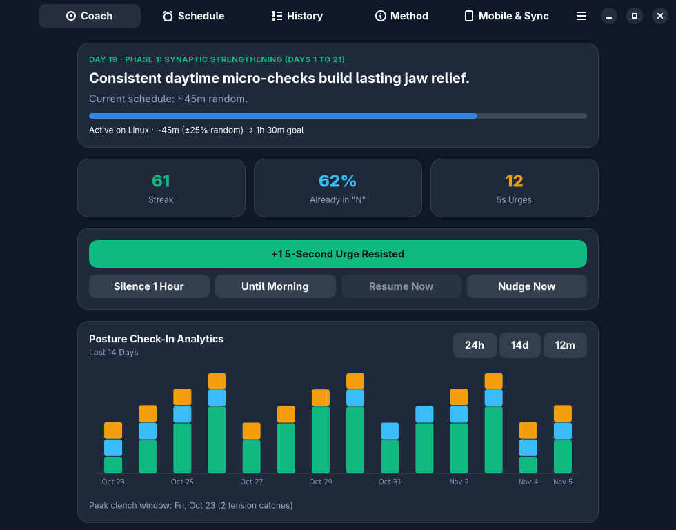
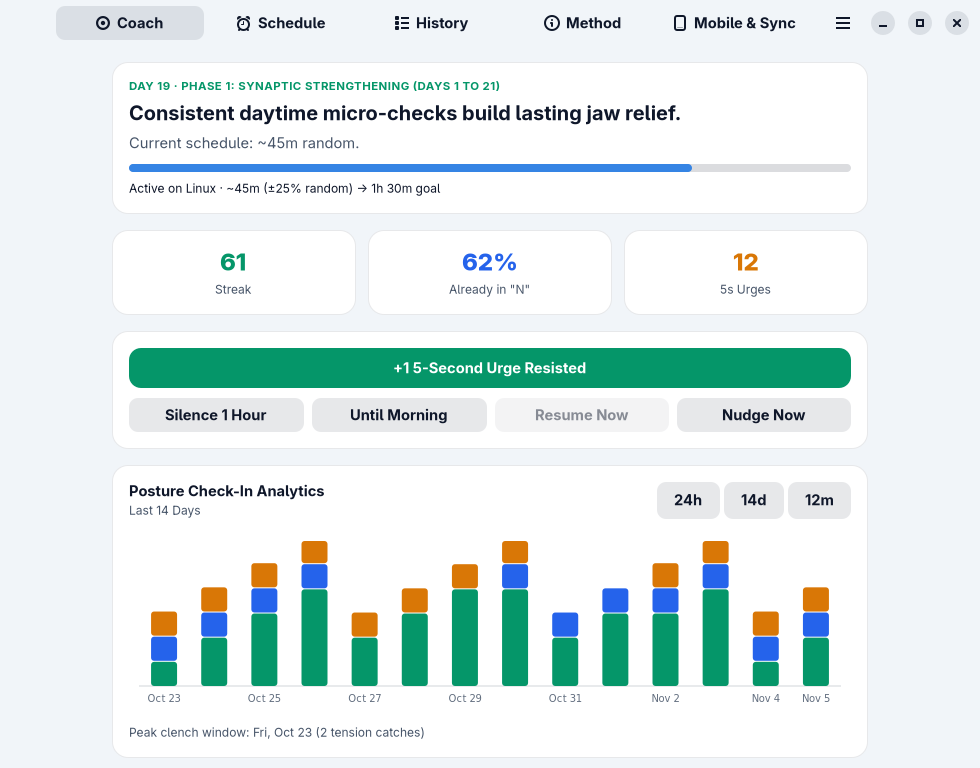
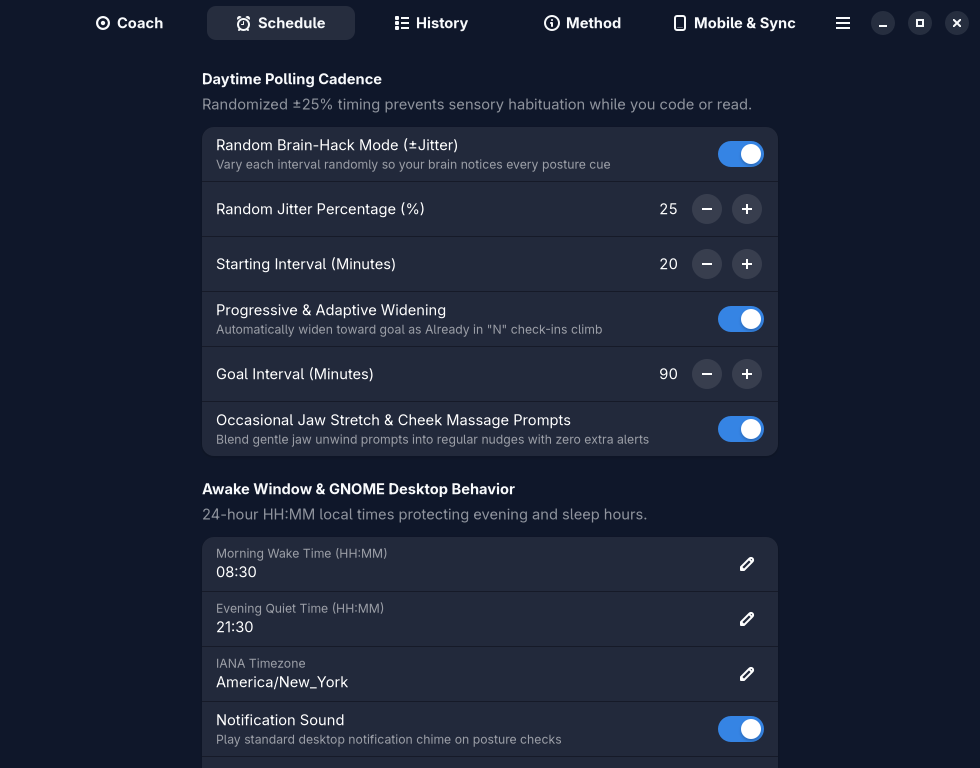
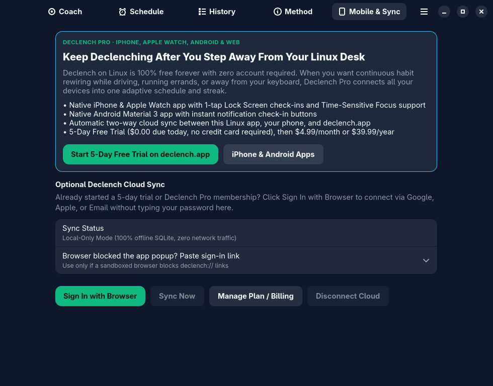

# Declench for Linux (`app.declench.linux`)

**Interrupt unconscious daytime jaw clenching while you code, write, and focus — and train a relaxed jaw as your default baseline.**

Built with **GTK 4 + Libadwaita** for GNOME Linux by **Silas Meadow Labs** · [declench.app](https://declench.app)



---

## What Is Declench?

Unconscious daytime jaw clenching and tooth bracing (*awake bruxism*) runs like a hidden background process. The moment your attention locks onto deep work — debugging code, reviewing pull requests, writing, or gaming — your masseter and temporalis muscles silently clamp down without you noticing.

Sticky notes on your monitor fade into the background after a day. Nightguards protect enamel while you sleep, but don't stop you from clenching into plastic or bracing all afternoon. And predictable fixed-interval timers get tuned out by your brain within 48 hours.

**Declench replaces passive reminders with a closed-loop habit-rewiring system built around four behavioral mechanics:**

### 1. The Passive "N" Resting Posture
Say the letter **"N"** out loud and hold where your tongue lands:
- **Lips gently together**
- **Teeth slightly apart** (a relaxed 2–3 mm freeway space — zero tooth contact)
- **Tip of the tongue resting lightly** on the palatal ridge right behind your upper front teeth

Giving your jaw a specific, repeatable competing posture naturally disengages the jaw-closing muscles instead of leaving your bite hovering on the edge of a clench.

### 2. Variable-Interval ("Brain-Hack") Daytime Nudges
Predictable clock ticks trigger **sensory habituation** — your nervous system learns to ignore a fixed 30-minute chime. Declench randomizes every interval (`±25%` jitter by default) strictly inside your configured **Awake Window** (e.g., `08:30` to `21:30`), catching tension in the exact moment it happens while keeping your evenings and sleep undisturbed.

### 3. One-Click GNOME Notification Check-Ins & Adaptive Intervals
Every desktop nudge arrives with instant action buttons right inside the GNOME notification banner:
- **Already in "N"** — You were already relaxed when the nudge arrived. Declench widens your interval step-by-step toward your goal (e.g., `20m → 90m`).
- **Caught & Reset** — You caught yourself clenching and dropped back into "N". Adaptive coaching gently tightens or holds your cadence while tension is active.
- **5s Urge** — You noticed an urge to clench between alerts and rode it out for 5 seconds without biting down.
- **Silence 1h** — Pause nudges for deep meetings or presentations with one click.

### 4. Three-Phase Habit Telemetry & Jaw Unwind Prompts
Track your **Followed Streak**, **Already in "N" Automaticity Rate**, **5-Second Urges Resisted**, and **Peak Clench Windows** across 24-hour, 14-day, and 12-month stacked charts, with optional guided jaw stretch and cheek massage prompts blended into every *N*th check-in.

---

## Screenshots

| Adaptive Coach & 14-Day Analytics (Dark) | Adaptive Coach (Daylight Theme) |
| :---: | :---: |
|  |  |
| **Randomized Cadence & Quiet Hours** | **Optional Declench Pro Mobile & Web Sync** |
|  |  |

---

## 100% Free on Linux + Optional Declench Pro Cloud Sync

| Feature | Free Linux Desktop Mode | Declench Pro ([declench.app](https://declench.app)) |
| :--- | :--- | :--- |
| **Price** | **100% Free Forever** (MIT Open Source) | **5-Day Free Trial** (no card required), then $4.99/mo or $39.99/yr |
| **Account Required?** | **No** — 100% offline local SQLite | Optional 1-click **Sign In with Browser** (`PKCE` deep link) |
| **Randomized & Adaptive Schedule** | Included | Synced live across all your devices |
| **24h / 14d / 12m Analytics & CSV/JSON Export** | Included | Synced across Desktop, Mobile & Web |
| **8 Curated Color Themes & Jaw Exercises** | Included | Synced across Desktop, Mobile & Web |
| **Keep Declenching Away From Your Desk** | Linux desktop only | **Web Push + iPhone & Android** nudges while driving, running errands, or away from your keyboard |

> **Honest Transparency:** Declench is a personal habit-awareness and posture coaching tool, not a medical or dental device, and does not diagnose, treat, or cure bruxism or TMJ disorders. Always consult a qualified dentist or physician for tooth wear, jaw pain, or sleep bruxism.

---

## Quick Install (GNOME Desktop Launcher)

Clone the repository and run `./install.sh` to create the local `.venv`, install the **Declench** icon and `.desktop` launcher into `~/.local/share/applications`, and register the `declench://` browser sign-in handler:

```bash
git clone https://github.com/SilasMeadowLabs/declench-linux-release.git
cd declench-linux-release
./install.sh
```

Or build and install as a sandboxed Flatpak (`app.declench.linux`):

```bash
./install.sh --flatpak
```

## Build & Install Flatpak Manually

```bash
flatpak install flathub org.flatpak.Builder org.gnome.Platform//51 org.gnome.Sdk//51
flatpak run --filesystem="$(pwd)" org.flatpak.Builder --user --install --force-clean build-flatpak app.declench.linux.json
flatpak run app.declench.linux
```

## Build & Validate Meson + AppStream Metadata

```bash
meson setup builddir --prefix=/app
ninja -C builddir
meson test -C builddir -v
```

## Run Locally from Source (Python Venv)

```bash
python3 -m venv --system-site-packages .venv
./run-local.sh
```

CLI flags:
- `--background`: Start hidden in background notification mode (ideal for GNOME Startup Applications)
- `--trigger-now`: Fire an immediate desktop posture check-in notification
- `--restart`: Cleanly restart a running `app.declench.linux` instance
- `--version`: Print version and exit

## Run Unit Tests

```bash
.venv/bin/pip install pytest
PYTHONPATH=src .venv/bin/pytest tests -v
```

---

## Uninstall & Clean Up Mobile Sync / Local Data

### Clean Up or Reset Mobile Sync Data

- **From inside the app**:
  1. Open the **Mobile & Sync** tab and click **Disconnect Cloud** (clears your saved `declench.app` bearer token in `~/.config/declench/cloud_session.json`).
  2. Open the **History** tab and click **Delete All Local History** if you also want to clear synced check-ins and reset your local schedule to a fresh offline state.
- **From the terminal (one command)**:
  ```bash
  ./install.sh --reset-sync
  ```
  Stops any running Declench instance and deletes both the cloud session (`~/.config/declench/`) and local SQLite database (`~/.local/share/declench/declench.sqlite3`, plus `~/.var/app/app.declench.linux/` if using Flatpak).

### Remove Declench from Your Computer

- **Uninstall the GNOME launcher & Flatpak (keeping local SQLite data)**:
  ```bash
  ./install.sh --uninstall
  ```
- **Uninstall and purge all local + mobile sync data**:
  ```bash
  ./install.sh --uninstall --purge
  ```

### Data File Locations

| Mode | Cloud Sync Token | Local SQLite Database |
| :--- | :--- | :--- |
| **Local / Venv** | `~/.config/declench/cloud_session.json` | `~/.local/share/declench/declench.sqlite3` |
| **Flatpak (`app.declench.linux`)** | `~/.var/app/app.declench.linux/config/declench/cloud_session.json` | `~/.var/app/app.declench.linux/data/declench/declench.sqlite3` |

---

## License

Released under the [MIT License](./LICENSE). Copyright (c) 2026 Silas Meadow Labs.
